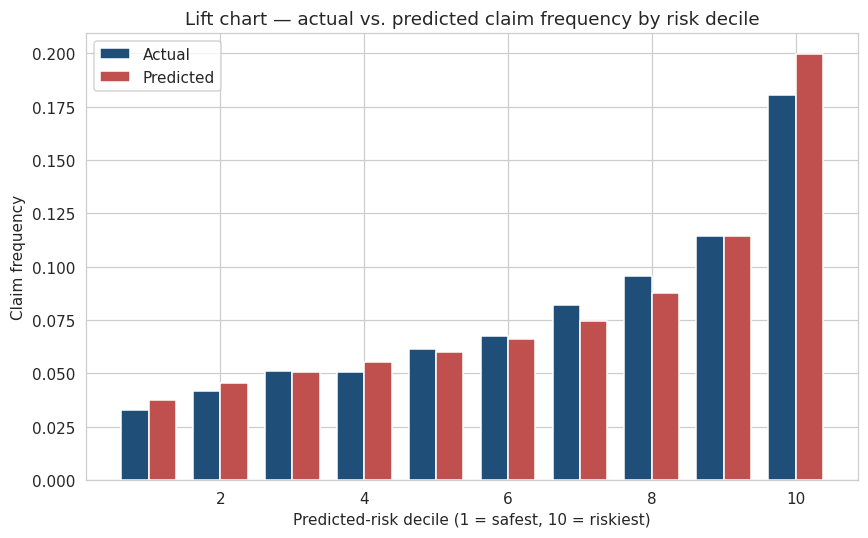

# Auto Insurance Claim-Frequency Pricing Model

A Poisson GLM built on **677,991 real French auto insurance policies** — the same modeling technique P&C actuaries use to price personal auto today.

**Author:** Tori · Business Analytics + Risk Management, Canfield BHP (UT Austin) · Actuarial track

---

## Headline results

| Metric | Value | Benchmark |
|---|---|---|
| Gini coefficient | **0.27** | 0.24 in Noll–Salzmann–Wüthrich (2018) for a comparable GLM |
| Riskiest vs. safest decile | **5.5× frequency spread** (18.0% vs. 3.3%) | — |
| Test-deviance improvement over mean-rate baseline | **3.0%** | — |
| Portfolio frequency | 7.4 claims / 100 policy-years | Matches French market experience |

The lift chart is monotone across all 10 deciles and predicted heights track actual heights, so the model is both well-ranked and well-calibrated.



---

## Why this project

Personal-auto ratemaking is built on the frequency-severity decomposition:

> **Pure premium = E[N] × E[X]** — expected claim count × expected claim size

This project builds the **frequency half** — the harder, more predictive half — using the industry-standard specification: a **Poisson GLM with a log link and an exposure offset**. That specification is the workhorse of Werner & Modlin's *Basic Ratemaking* and of every carrier's pricing shop; the coefficients translate directly into filed rating factors.

## Dataset

`freMTPL2freq` — 677,991 French auto TPL policies, sourced from the CASdatasets R package. The canonical actuarial benchmark dataset, used across the academic pricing literature (Wüthrich, Charpentier, and others).

**12 features covering:** driver age, vehicle characteristics (power, age, brand, fuel), Bonus-Malus (French no-claims discount), geography (region, area type, population density), exposure, and claim count.

## Approach

1. **Data cleaning** — cap outliers at values used in the standard literature (Noll–Salzmann–Wüthrich 2018).
2. **EDA** — one-way empirical frequency views across the four most predictive variables. Confirmed the classic U-shape by driver age and the strong Bonus-Malus signal.
3. **Poisson GLM** with `log(Exposure)` offset, fit on an 80% train split.
4. **Evaluation** on a 20% held-out test set:
   - **Lift chart** by predicted-risk decile (industry-standard visualization)
   - **Gini coefficient** on the concentration curve (industry-standard scalar)
   - Test-set **Poisson deviance** vs. a mean-rate baseline
5. **Interpretation** — `exp(coefficient)` reported as multiplicative rating factors.

## Files

| File | What it is |
|---|---|
| `Auto_Insurance_Frequency_GLM.ipynb` | Main deliverable — narrated end-to-end analysis with executed outputs |
| `analysis.py` | Same analysis as a runnable script |
| `01_eda.png`, `02_lift_chart.png`, `03_gini.png` | Exported plots |
| `coefficients.csv` | Full coefficient table with p-values and rating factors |
| `freMTPL2freq.rda` / `.csv` | Raw and CSV-converted dataset |

## Reproducing

```bash
pip install pandas numpy statsmodels matplotlib seaborn scikit-learn rdata
python analysis.py            # end-to-end script
# — or open the notebook —
jupyter notebook Auto_Insurance_Frequency_GLM.ipynb
```

## Extensions I'd add with more time

- **Gamma GLM for severity** on `freMTPL2sev` (paired dataset) → true pure-premium model.
- **Penalized regression / GBM** as a challenger; compare Gini and lift-chart flatness.
- **Splines on continuous variables** (driver age especially) — the U-shape is currently swallowed by the linear term.
- **Formal loss-cost relativity table** — the way a rate filing would present it to a state DOI.

## What it demonstrates

- Working knowledge of the **frequency-severity ratemaking framework**.
- Fluency with **GLMs, exposure offsets, and Poisson-family assumptions**.
- Ability to evaluate a model the way an insurance pricing team actually does — lift chart + Gini, not just RMSE.
- Ability to **read coefficients as rating factors** and translate model output into filing-ready language.

---

*Data source: `freMTPL2freq` via the [CASdatasets](https://github.com/dutangc/CASdatasets) R package. See Wüthrich, M. V. & Buser, C. (2023), *Data Analytics for Non-Life Insurance Pricing* for the reference treatment of this dataset.*
